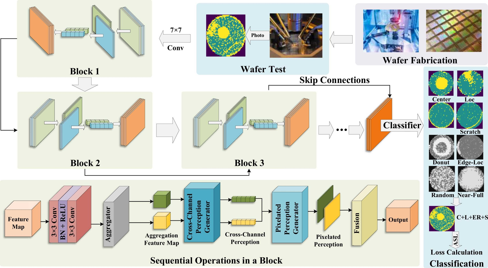
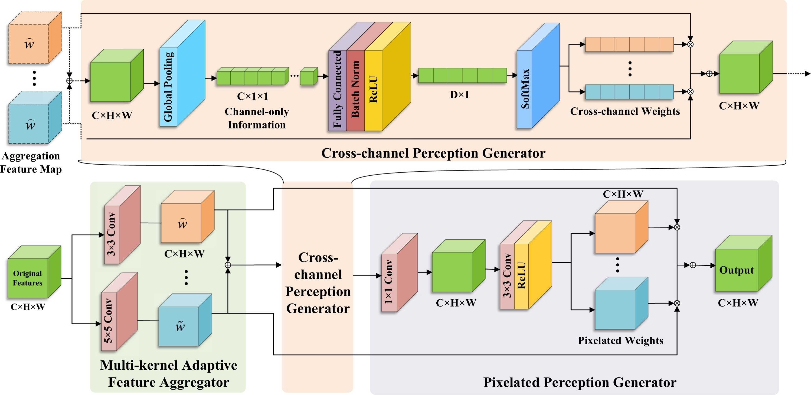
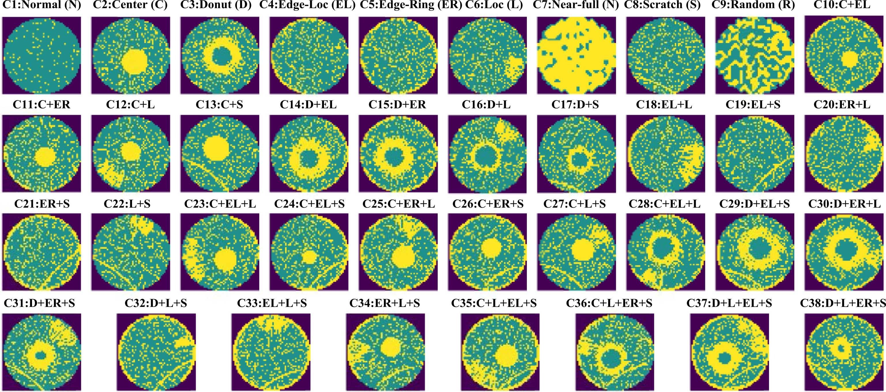

# Wafer Composite Defect Recognition Framework based on Residual Dynamic Perception Network with Asymmetric Multi-Label Loss

This repository provides a implementation of RDP-Net in the following paper:

- **Title**: Wafer composite defect recognition framework based on residual dynamic perception network with asymmetric multi‑label loss
- **DOI**: [10.1016/j.isatra.2025.09.005](https://doi.org/10.1016/j.isatra.2025.09.005)




## Highlights

- A high-performing framework based on deep learning is proposed for wafer composite defect recognition.
- An easy-to-integrate information fusion module is proposed and proven to be effective.
- The Asymmetric Loss is introduced to improve the performance on multi-label classification tasks.
- Visualized experiments contribute to the interpretable analysis of deep learning in industries.



## Repository Structure
- `src/rdpnet/`
  - `models/rdpnet.py` — RDPNet model (ResNet‑like with SKAttention)
  - `losses.py` — Asymmetric multi‑label loss (ASL) variants
  - `data.py` — Dataset loading and DataLoader helpers for the provided `.npz`
  - `eval.py` — Evaluation utilities (per‑class metrics and mean accuracy)
  - `utils.py` — Seeding and label utilities
- `scripts/`
  - `train.py` — Train entrypoint
  - `evaluate.py` — Evaluate entrypoint
- `Wafer_Map_Datasets.npz` — Dataset file, available at [Kaggle](https://www.kaggle.com/datasets/co1d7era/mixedtype-wafer-defect-datasets)
- `requirements.txt` — Minimal dependencies

## Installation
- Python 3.8+
- PyTorch

Install dependencies:

```
pip install -r requirements.txt
```

If you need a specific CUDA build of PyTorch, please follow the official PyTorch instructions, then install the remaining packages from `requirements.txt`.

## Dataset
The default code expects `Wafer_Map_Datasets.npz` at the project root, containing:
- `arr_0`: input arrays shaped `(N, H, W)`
- `arr_1`: multi‑label targets shaped `(N, 8)` with 0/1 values

The 8‑bit labels encode composite classes C1..C38 used for evaluation.

## Quick Start
Train (BCE):

```
python scripts/train.py --data Wafer_Map_Datasets.npz --epochs 100 --batch-size 128 --lr 1e-3
```

Train with Asymmetric Multi‑Label Loss (ASL):

```
python scripts/train.py --data Wafer_Map_Datasets.npz --asl
```

Evaluate a checkpoint:

```
python scripts/evaluate.py --data Wafer_Map_Datasets.npz --ckpt checkpoint/best.mdl
```

Notes:
- Checkpoints are saved to `checkpoint/` each epoch; the best model overwrites `checkpoint/best.mdl`.
- Training logs (epoch, loss) append to `train_data.csv` in the project root.

## How It Works
- Model: `RDPNet` is a ResNet‑like backbone enhanced with SKAttention blocks for dynamic multi‑scale feature aggregation. The final head outputs 8 probabilities (multi‑label) in `[0,1]`.
- Loss: You can choose standard `BCELoss` or `AsymmetricLoss` (ASL). ASL down‑weights easy negatives and emphasizes rare positives.
- Evaluation: Predictions are thresholded (`>= 0.5`) per label and mapped to composite classes (C1..C38). Mean accuracy over C1..C38 is reported; per‑class precision/recall/F1 are also computed.

## Citation
If you use this codebase, please cite the associated paper.

```
@article{liu2025wafer,
title = {Wafer composite defect recognition framework based on residual dynamic perception network with asymmetric multi-label loss},
journal = {ISA Transactions},
year = {2025},
issn = {0019-0578},
doi = {https://doi.org/10.1016/j.isatra.2025.09.005},
url = {https://www.sciencedirect.com/science/article/pii/S0019057825005105},
author = {Jiale Liu and Huan Wang},
keywords = {Semiconductor manufacturing, Wafer defect recognition, Convolutional neural network, Attention mechanism},
}
```
